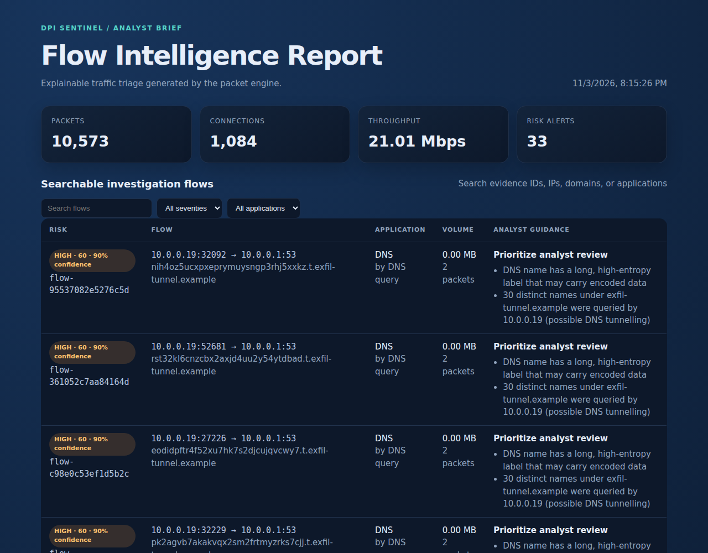
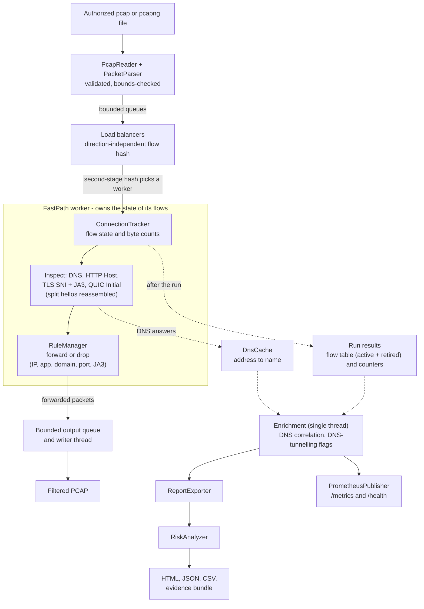

# DPI Sentinel


**DPI Sentinel** is a local-first Java 17 deep-packet-inspection and
network-security platform for **authorized packet-capture files**. It is an
**offline analyser**: it reads captures and never sniffs live traffic. It
turns raw packets into flow state, visible application metadata, policy
decisions, explainable risk findings, reports, metrics, and reproducible
investigation evidence.

> **Use responsibly:** inspect only traffic and networks that you own or are
> explicitly authorized to monitor.

---

## Why this project is different

This is more than a packet parser. It combines:

- Safe Ethernet, VLAN, IPv4, IPv6 metadata, TCP, and UDP parsing.
- Five-tuple flow tracking with stateful connection processing.
- Flow-affinity routing to bounded concurrent workers.
- Visible DNS, HTTP Host, TLS SNI (including a ClientHello split across TCP segments), and QUIC v1/v2 SNI recovered per RFC 9001/9369, even when the hello is split across several Initial packets.
- JA3 TLS client fingerprinting (with a block-by-fingerprint rule), TLS version detection, and DNS-answer correlation for flows that hide their SNI.
- DNS-tunnelling heuristics (encoded-looking labels and many distinct names under one domain).
- Classic pcap and pcapng input; fuzz-tested parsers that account for every frame.
- Application/domain classification and configurable blocking rules.
- Deterministic, explainable risk scoring rather than an opaque verdict.
- HTML, JSON, CSV, filtered-PCAP, and hashed evidence outputs.
- Prometheus metrics, health checks, Docker support, and CI quality gates.

It intentionally does **not** decrypt TLS, prove that a host is compromised,
or claim to replace a production IDS, firewall, SIEM, or malware sandbox.

## Table of contents

- [Quick start](#quick-start)
- [What the engine produces](#what-the-engine-produces)
- [Architecture](#architecture)
- [Core processing flow](#core-processing-flow)
- [Risk and evidence model](#risk-and-evidence-model)
- [Commands](#commands)
- [Configuration](#configuration)
- [Advanced analysis](#advanced-analysis)
- [Monitoring](#monitoring)
- [Docker](#docker)
- [Testing and benchmarks](#testing-and-benchmarks)
- [Project structure](#project-structure)
- [Security model and limitations](#security-model-and-limitations)
- [Authorization and privacy](#authorization-and-privacy)
- [Contributing](#contributing)
- [License](#license)

---

## Quick start

### Prerequisites

- Bash-compatible shell on Linux or macOS.
- Java 17 or newer.
- Maven.
- Python 3 for synthetic PCAP generation (`pip install cryptography` is optional and only used to build real encrypted QUIC packets in the sample).
- Docker Desktop or Docker Engine only for containerized monitoring/runtime.

### Run the included demonstration

```bash
git clone https://github.com/NIHAL29SINGH/Deep-Packet-Inspection-System.git
cd Deep-Packet-Inspection-System

chmod +x dpi Packet_analyzer-main/java-port/*.sh
./dpi setup
./dpi build
./dpi demo
```

Open the generated analyst report:

```text
Packet_analyzer-main/java-port/outputs/demo.html
```

The demo uses:

```text
Packet_analyzer-main/sample_traffic.pcap
```

### Run the complete validation path

```bash
./dpi create-test
./dpi test
./dpi verify
./dpi smoke
```

---

## What the engine produces

| Output | Purpose |
| --- | --- |
| Filtered PCAP | Packets that remain after policy evaluation |
| HTML report | Analyst-friendly traffic, performance, and risk report |
| JSON report | Machine-readable statistics and findings |
| CSV report | Flow-level data for analysis in spreadsheets or pipelines |
| Evidence bundle | Reports, filtered PCAP, manifest, and SHA-256 hashes |
| Prometheus metrics | Packet, byte, throughput, latency, worker, and resource data |
| Health endpoint | Simple process health response for monitoring |



*The analyst report generated from the bundled sample capture: flows are ranked by
risk first, so the DNS-tunnelling burst (with the reason for each finding and what the
classification rests on) leads, followed by the Telnet, RDP and backdoor-port flows.*

The default demo writes:

```text
Packet_analyzer-main/java-port/outputs/demo.html
Packet_analyzer-main/java-port/outputs/demo.json
Packet_analyzer-main/java-port/outputs/demo.csv
Packet_analyzer-main/java-port/outputs/output_demo.pcap
```

---

## Architecture

The full architecture, data-flow, concurrency, monitoring, and trust-boundary
diagrams are maintained in
[docs/ARCHITECTURE.md](docs/ARCHITECTURE.md).

### System at a glance



Reading the diagram: packets flow through bounded queues, and each worker handles
inspection and policy inline for its own flows. DNS answers are remembered in a shared
cache; after the workers stop, one single-threaded pass correlates flows that hid their
SNI and flags tunnelling, and only then are reports and metrics built from that snapshot,
not streamed packet by packet. DPI Sentinel
only reads capture files; it has no live-capture mode.

### Architectural decisions

| Decision | Why |
| --- | --- |
| Direction-independent five-tuple hashing | Both directions of a conversation (request and reply) reach the same worker and the same flow record |
| Bounded queues | Applies backpressure instead of allowing unbounded memory growth |
| Connection-local state | Reduces shared mutable state and lock contention |
| Local processing | Keeps packet contents on the analysis host |
| Explainable heuristics | Gives analysts findings and reasons instead of an opaque score |
| SHA-256 evidence IDs | Correlates flows without using raw endpoints as the primary identifier |

See [ADR-001-flow-affinity.md](docs/ADR-001-flow-affinity.md) for the concurrency
decision and [THREAT_MODEL.md](docs/THREAT_MODEL.md) for assets, trust
boundaries, controls, and limitations.

---

## Core processing flow

1. `PcapReader` validates the capture header and reads one frame at a time.
2. `PacketParser` checks lengths and decodes Ethernet, VLAN, IP, TCP, and UDP metadata.
3. Eligible IPv4 TCP/UDP packets become `PacketJob` instances.
4. `LBManager` hashes each five-tuple to a load-balancer path.
5. Bounded queues dispatch work to `FastPathProcessor` workers.
6. `ConnectionTracker` maintains packet counts, byte counts, state, application, and SNI.
7. Protocol extractors inspect visible DNS, HTTP Host, TLS SNI (with ClientHello reassembly), and QUIC v1 Initial packets.
8. `RuleManager` evaluates IP, application, domain, and port policies.
9. The engine forwards permitted packets to a filtered PCAP and drops blocked packets.
10. `RiskAnalyzer` adds deterministic findings, severity, confidence, evidence IDs, and recommendations.
11. Report builders export HTML, JSON, CSV, and investigation artifacts.
12. Prometheus metrics and health output expose the run to monitoring tools.

### Supported visible metadata

| Protocol/area | Behavior |
| --- | --- |
| Ethernet/VLAN | Header parsing and VLAN-aware offsets |
| IPv4 | Main flow-processing path |
| IPv6 | Safe metadata parsing; not the same full IPv4 DPI path |
| TCP/UDP | Tuple creation, state, ports, counters |
| DNS | Best-effort query/domain extraction |
| HTTP | Visible `Host` extraction |
| TLS | Visible SNI extraction, with in-order reassembly of a ClientHello split across TCP segments; application data is not decrypted |
| QUIC | v1 client Initial packets are decrypted with the public Initial keys (RFC 9001) to read the SNI; later packets of the flow are not inspected |

---

## Risk and evidence model

Risk scoring is deterministic heuristic triage. It helps prioritize analyst
review; it is not proof of compromise.

Signals can include:

- A flow blocked by policy.
- Clear-text legacy services such as Telnet.
- Remote-administration or file-sharing ports.
- Configured high-risk ports.
- Encrypted traffic without visible SNI.
- Unknown application classification.
- Encoded or unusual numeric domain patterns.
- Strong outbound byte asymmetry that may warrant exfiltration review.

Each scored flow can include:

```text
Risk score
Severity
Confidence
Evidence ID
Findings
Recommended action
```

Risk and confidence are separate:

- **Risk** estimates how concerning the observed behavior is.
- **Confidence** estimates how strongly the available observations support the finding.

### Evidence bundle

```bash
./dpi evidence
```

Generated files:

```text
Packet_analyzer-main/java-port/outputs/investigation/
├── MANIFEST.txt
├── investigation.html
├── investigation.json
├── investigation.csv
└── output_investigation.pcap
```

The manifest records the source capture hash, generated artifact hashes,
generation time, engine commit, and privacy notes. Evidence IDs are stable
pseudonymous SHA-256 correlation identifiers.

---

## Commands

Run commands from the repository root.

| Command | Purpose |
| --- | --- |
| `./dpi help` | Show the command reference |
| `./dpi setup` | Check Java, Maven, Python, and optional Docker |
| `./dpi build` | Compile and package the Java engine |
| `./dpi demo` | Process the included sample and generate a report |
| `./dpi inspect` | Analyze the sample and write a filtered PCAP |
| `./dpi report` | Generate HTML, JSON, CSV, and filtered-PCAP outputs |
| `./dpi replay` | Reprocess the sample end to end |
| `./dpi evidence` | Create the hashed investigation bundle |
| `./dpi benchmark` | Compare 1, 2, 4, and 8 worker configurations |
| `./dpi block-app YouTube` | Block an application |
| `./dpi block-site facebook.com` | Block a domain |
| `./dpi block-address 192.168.1.10` | Block an IP address |
| `./dpi inspect cap.pcapng --block-ja3 <md5>` | Block a TLS client fingerprint (any option can follow a capture file) |
| `./dpi create-test` | Generate a synthetic test PCAP |
| `./dpi show-rules` | Display active risk rules |
| `./dpi test` | Run unit and integration tests |
| `./dpi verify` | Run Maven verification |
| `./dpi smoke` | Run the offline smoke test |
| `./dpi start-monitoring` | Start Prometheus and Grafana |
| `./dpi stop-monitoring` | Stop monitoring services |
| `./dpi monitoring-status` | Show monitoring service status |
| `./dpi docker-start` | Start the DPI Docker profile and monitoring |
| `./dpi docker-stop` | Stop Docker services |
| `./dpi docker-status` | Show Docker service status |
| `./dpi clean` | Remove build and generated output |

### Analyze another capture

```bash
./dpi inspect my-traffic.pcap
./dpi report incident my-traffic.pcap
./dpi evidence my-traffic.pcap
./dpi benchmark my-traffic.pcap
```

### Apply blocking rules

```bash
./dpi block-app YouTube
./dpi block-site example.com
./dpi block-address 10.0.0.25
```

Blocking uses available visible metadata. Encrypted payload contents are not
decrypted, so a domain can only be blocked when the domain is observable.

---

## Configuration

### Risk rules

Risk-scoring defaults are stored in:

```text
risk-rules.properties
```

Inspect them:

```bash
./dpi show-rules
```

The file supports scores such as `blocked_flow_score`,
`missing_sni_score`, `unknown_application_score`, and
`outbound_asymmetry_score`, plus comma-separated port lists such as
`cleartext_ports`, `sensitive_ports`, and `high_risk_ports`.

Values are validated before the engine starts.

### Engine tuning

The Java engine supports:

```text
--lbs <n>              Number of load-balancer paths
--fps <n>              Fast-path workers per load balancer
--rules <file>         Policy rules file
--risk-rules <file>    Risk scoring file
--save-rules <file>    Save active rules
--verbose              Print policy decisions
```

Metrics/report options include:

```text
--report-csv <file>
--report-json <file>
--report-html <file>
--metrics-port <port>
--metrics-bind <addr>
--metrics-hold <sec>
--metrics-file <file>
--no-metrics
```

---

## Advanced analysis

All of this works offline on a capture file; nothing is captured live.

**Input formats.** Classic pcap (microsecond or nanosecond, either byte order) and pcapng (multiple sections and
interfaces, any timestamp resolution). Only Ethernet link types are analysed; other interfaces in a pcapng file are skipped and counted.

**QUIC.** Initial packets of QUIC v1 and v2 are decrypted with the public Initial keys (RFC 9001, RFC 9369) to read the
ClientHello. Modern clients split that hello over several Initial packets; the worker reassembles the CRYPTO fragments within a
fixed memory budget. Keys are verified against the RFC key-derivation values and packets built by an independent Python implementation.

**JA3 fingerprints.** Every TLS ClientHello (single segment or reassembled) is fingerprinted. The JSON/CSV/HTML reports show the JA3
hash and the highest TLS version offered. Block a client implementation by fingerprint, or put hashes on a watchlist in `risk-rules.properties`:

```bash
./dpi inspect cap.pcap --block-ja3 e7d705a3286e19ea42f587b344ee6865
```

A fingerprint identifies a *client implementation*, not a person, and any client can imitate another's hello, so it is a triage signal.

**DNS correlation.** DNS answers in the capture are remembered, so a TLS flow with no visible SNI (for example with Encrypted Client Hello)
can still be tied to the name DNS resolved for its server address. The report marks this as `classified_by: DNS answer` and never
pretends the name was an SNI.

**DNS tunnelling heuristics.** A DNS name with a long, hyphen-free, high-entropy label raises a finding, and so does one client asking for
many distinct names (default 20) under a single domain. Both are tunable in `risk-rules.properties` and have known false positives, so they only add to
the explainable risk score.

**Explainability.** Every flow records what its classification rests on (`TLS SNI`, `HTTP Host`, `QUIC Initial`, `DNS query`, `DNS answer`, or `port`).

**Robustness.** Seeded fuzz tests mutate valid traffic (bit flips, truncation, garbage) and corrupt capture files; every frame must be inspected or
counted as skipped, and a corrupt file may only fail with a clear `IOException`.

---

## Monitoring

Start Prometheus and Grafana:

```bash
./dpi start-monitoring
```

Open:

```text
Prometheus: http://localhost:9090
Grafana:    http://localhost:3001
DPI metrics: http://localhost:9400/metrics
Health:      http://localhost:9400/health
```

Development Grafana credentials:

```text
Username: admin
Password: admin
```

Change these before any non-local deployment.

The monitoring Compose stack is separate from the root `docker-compose.yml`.
Prometheus is configured to scrape `host.docker.internal:9400`, which is
appropriate for the documented local workflow. Metrics include:

- Total packets and bytes.
- Forwarded and dropped packets.
- Packets per second and throughput.
- Processing latency.
- CPU and memory snapshots.
- Worker distribution.
- Application and domain counts.

Stop or inspect monitoring:

```bash
./dpi stop-monitoring
./dpi monitoring-status
```

---

## Docker

Docker is optional for offline analysis and packages the Java runtime
consistently.

```bash
./dpi docker-start
./dpi docker-status
./dpi docker-stop
```

Equivalent commands:

```bash
docker build -t dpi-sentinel .
docker compose --profile dpi up --build
docker compose --profile dpi down
```

The image uses Maven with Eclipse Temurin Java 17 for the build and a Java 17
JRE for runtime. The container only needs read access to your capture files.

The metrics endpoint listens on `127.0.0.1` by default. Inside a container it must
listen on all interfaces for the published port to work, so pass
`--metrics-bind 0.0.0.0` there and keep the port off untrusted networks.

---

## Testing and benchmarks

### Tests

```bash
./dpi test
./dpi verify
./dpi smoke
```

The suite (130 tests) covers:

- DNS, HTTP, TLS, QUIC, and malformed extractor inputs, including hostile hostnames.
- A QUIC Initial test vector built by an independent implementation, plus the RFC 9001 key-derivation values.
- IPv4 TCP/UDP parsing, VLAN, IPv6 metadata, IP fragments, Ethernet padding, truncated frames.
- Classic (microsecond, nanosecond, either byte order) and pcapng captures, including a Python-generated pair that must produce identical packets and flows; corrupt and non-Ethernet captures.
- QUIC v1 and v2 (including RFC 9369 key values), a ClientHello split across two Initial packets and reassembled by the worker.
- JA3 fingerprints checked against an independent implementation (with GREASE values), JA3 blocking, DNS answer parsing and correlation, DNS-tunnelling detection.
- Seeded fuzzing of every parser and extractor (about 60,000 mutated or random inputs) and of the capture readers.
- Flow direction, bidirectional flow affinity, worker distribution, flow retirement and eviction.
- TLS ClientHello reassembly (split, out-of-order, memory budget).
- Rule matching (domain boundaries, either-endpoint IPs, save/load) and deterministic risk scoring.
- End-to-end runs through the real multi-threaded pipeline, and report safety (valid JSON, no script breakout, CSV formula neutralisation).

Each fix in [docs/CHANGELOG.md](docs/CHANGELOG.md) has a regression test that fails when the original bug is reintroduced.

### Coverage

```bash
cd Packet_analyzer-main/java-port
mvn verify -Pcoverage-80
cd ../..
```

The default build enforces 50% line coverage (JaCoCo, `mvn verify`); the
`coverage-80` profile enforces an 80% target. CI uploads the JaCoCo report as an artifact.

### Benchmark

```bash
./dpi benchmark
```

The benchmark compares 1, 2, 4, and 8 processing-worker configurations and
writes:

```text
Packet_analyzer-main/java-port/outputs/benchmark.csv
```

It measures local throughput and peak memory for the selected capture. It is
not a JMH benchmark and does not measure detection precision, recall, false
positives, or false negatives on a labeled dataset.

Measured numbers, the method, and the caveats (single shared vCPU, so no
multi-core scaling claim is made) are in [docs/BENCHMARKS.md](docs/BENCHMARKS.md).

---

## Project structure

```text
.
├── .github/workflows/
│   ├── ci.yml
│   ├── codeql.yml
│   └── quality.yml
├── docs/
│   ├── ADR-001-flow-affinity.md
│   ├── ADR-002-flow-lifecycle-and-reassembly.md
│   ├── ARCHITECTURE.md
│   ├── BENCHMARKS.md
│   ├── CHANGELOG.md
│   ├── THREAT_MODEL.md
│   └── img/report.png
├── LICENSE
├── SECURITY.md
├── Dockerfile
├── docker-compose.yml
├── dpi
├── risk-rules.properties
└── Packet_analyzer-main/
    ├── sample_traffic.pcap          (deterministic; reproduce with generate_sample_pcap.py)
    ├── generate_sample_pcap.py
    ├── generate_test_pcap.py
    └── java-port/
        ├── pom.xml
        ├── dpi.sh
        ├── benchmark.sh
        ├── smoke-test.sh
        ├── monitoring/
        ├── src/main/java/
        └── src/test/java/
```

| Package | Responsibility |
| --- | --- |
| `parser` | Ethernet, VLAN, IP, TCP, UDP, and safety checks |
| `pcap` | PCAP input and filtered output |
| `dpi` | DNS, HTTP, TLS, and QUIC metadata extraction |
| `engine` | Flow processing, concurrency, rules, risk, and reports |
| `monitoring` | Prometheus metrics and health endpoint |
| `app` | Java application entry point and CLI integration |
| `model` | Flows, packets, application types, states, and statistics |

---

## CI and code quality

GitHub Actions includes:

- Java build and offline smoke testing.
- CodeQL analysis.
- Checkstyle.
- SpotBugs.
- Dependency analysis.

The main local equivalents are:

```bash
./dpi build
./dpi test
./dpi verify
./dpi smoke
```

---

## Security model and limitations

See [docs/THREAT_MODEL.md](docs/THREAT_MODEL.md) for the detailed threat
model and [docs/ARCHITECTURE.md](docs/ARCHITECTURE.md) for trust boundaries.

Current limitations are intentional:

- The main DPI processing path is IPv4 TCP/UDP.
- IPv6 metadata is parsed safely but does not use the same full IPv4 flow path.
- TCP reassembly is limited to the client's first TLS record and only for in-order segments; general stream reassembly, out-of-order handling and retransmission recovery are not implemented.
- IPv4 fragments are counted and skipped; they are not reassembled.
- QUIC support covers v1 and v2 client Initial packets; draft versions are not decoded, and the first Initial packet must arrive before later ones so the hello can be sized.
- Only Ethernet captures are analysed (classic pcap and pcapng); other link types are rejected or skipped with a clear message.
- JA3 and the DNS heuristics are triage signals with known false positives, not verdicts.
- There is no live-capture mode by design.
- TLS application data is not decrypted.
- Risk scores are triage signals, not malware verdicts.
- No labeled benign/malicious dataset is included for accuracy claims.
- A full web investigation dashboard is not part of the current application.

---

---

## Authorization and privacy

DPI Sentinel processes packet data locally and does not upload it by default.
Reports can contain IP addresses, domains, SNI, traffic metadata, and
investigation findings. Treat generated files as sensitive artifacts and
retain/share them according to organizational policy and applicable law.

## Contributing

Before submitting a change:

1. Run `./dpi test`.
2. Run `./dpi verify`.
3. Run `./dpi smoke`.
4. Update the relevant documentation when behavior or commands change.
5. Include tests for parser, rule, risk, or report behavior when applicable.

Keep packet-processing changes safe for malformed input, preserve flow
affinity, and avoid claiming detection capabilities that are not supported by
the implementation and tests.

## License

Released under the [MIT License](LICENSE). The runtime has no third-party dependencies; build and test tools (JUnit,
JaCoCo, Maven plugins) keep their own licenses; review them before redistribution.
Always follow applicable laws, organizational policy, and authorization
requirements for the network being inspected.
