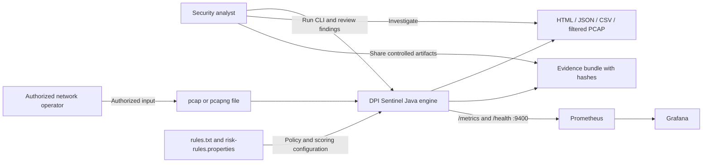
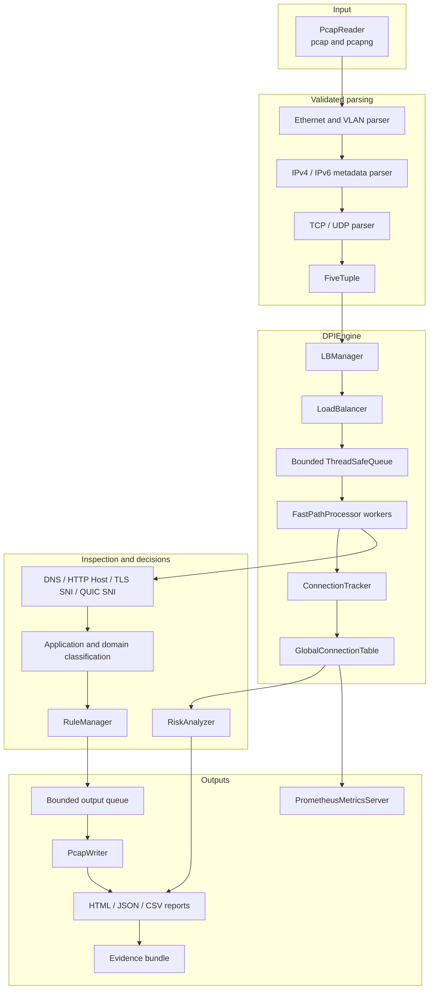
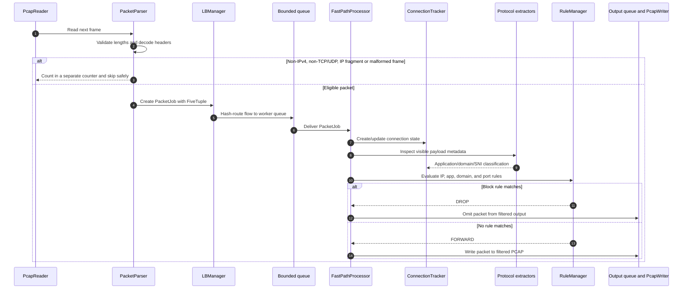
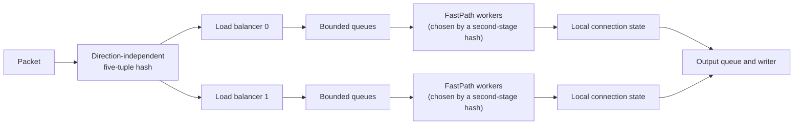
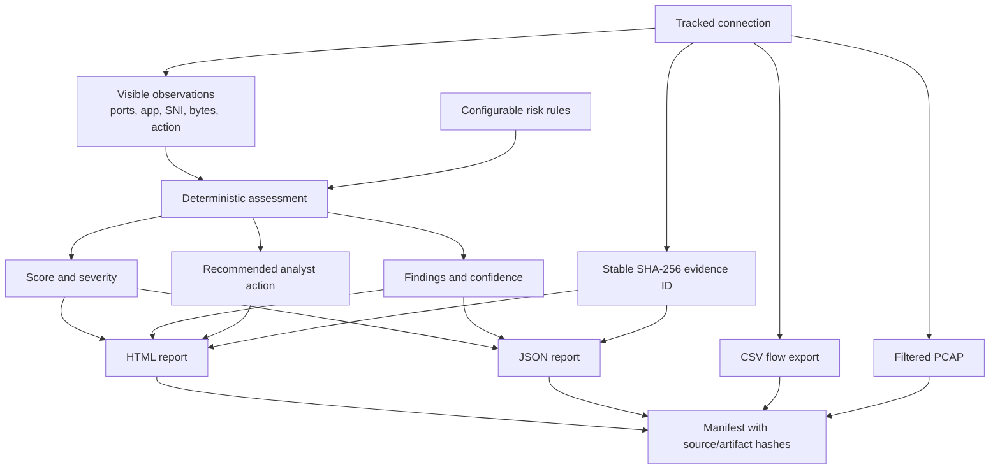
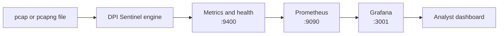
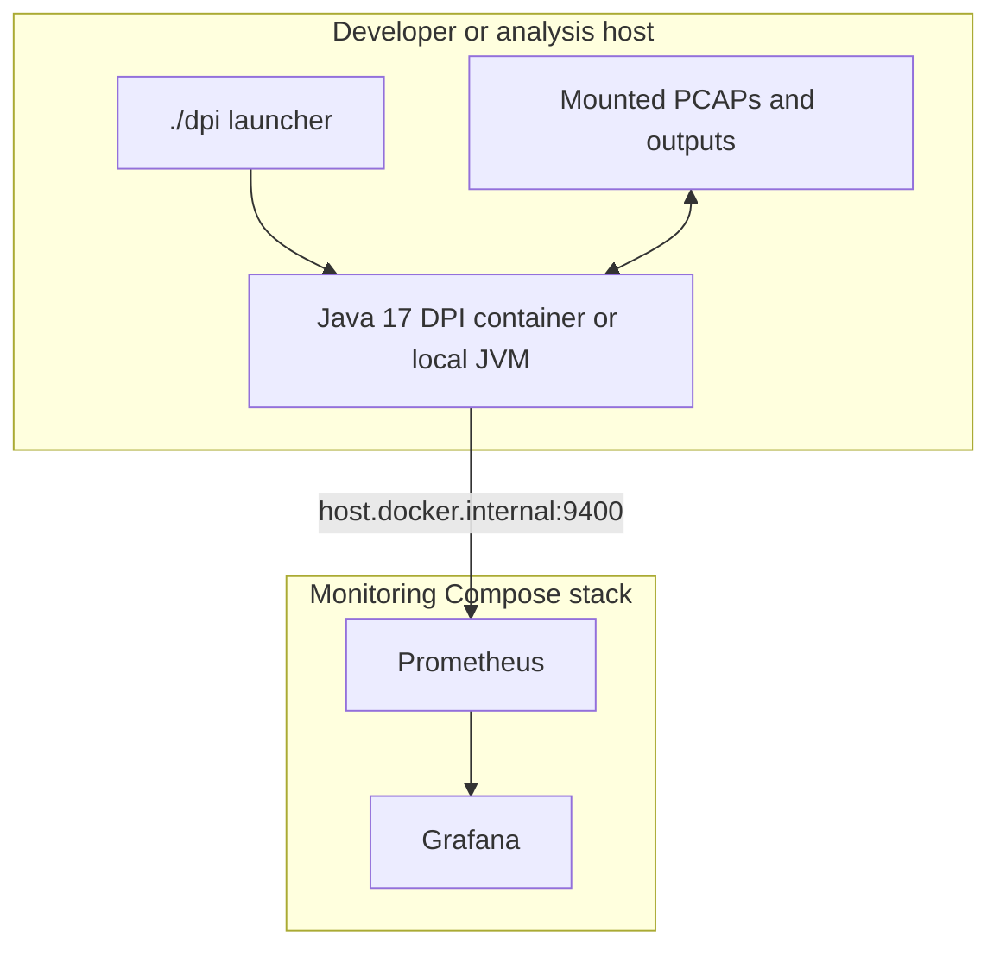
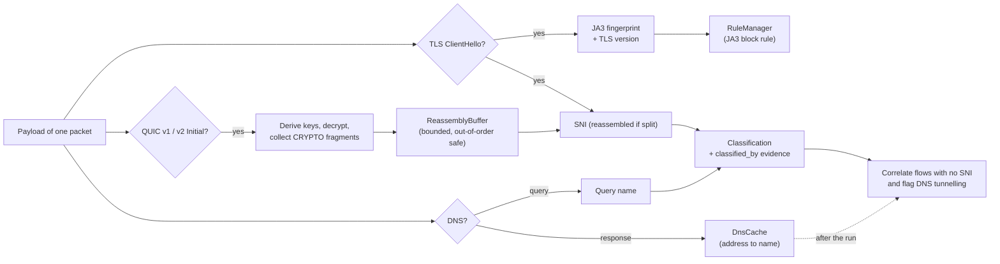

# DPI Sentinel Architecture

DPI Sentinel is a local-first Java 17 deep-packet-inspection and network-security
engine for authorized packet-capture files (offline analysis only). This document describes the
implemented data path, concurrency model, decision points, evidence outputs,
and observability boundaries.

> **Authorization:** Use the engine only on captures and networks that you own
> or are explicitly authorized to monitor.

## 1. System context

The engine processes data locally. It does not upload packet contents to a
remote service. Generated reports and evidence can contain sensitive network
metadata and must be handled according to the organization's security policy.

## 2. Component architecture

## 3. Offline packet-processing flow

The reader, worker queues, processors, and output writer have explicit
completion and drain behavior. Completion does not depend on a fixed sleep.
Malformed or truncated frames are rejected safely by the parser.

## 4. Flow affinity and concurrency

Packets belonging to the same conversation, in either direction, are routed to the same
load-balancer path and then to the same worker (the hash is direction-independent, and the
worker is picked with a different slice of the hash than the load balancer). This preserves connection-local state without requiring every packet
operation to lock a shared connection table. Bounded queues provide
backpressure; a hot flow can still create uneven distribution, which is an
explicit trade-off documented in [ADR-001](ADR-001-flow-affinity.md).

## 5. Risk, evidence, and report pipeline

Risk is explainable heuristic triage, not a malware verdict. Signals include
blocked policy flows, clear-text legacy services, sensitive/high-risk ports,
missing visible SNI, unknown applications, unusual domains, and strong
outbound byte asymmetry. Risk and confidence are reported separately.

## 6. Monitoring

The engine exposes plain-text `/metrics` and `/health` endpoints while a run
is active. The repository's monitoring Compose file starts Prometheus and
Grafana separately. The root Compose profile packages the DPI container; it
does not replace the monitoring Compose stack.

## 7. Deployment boundaries

The container only needs read access to capture files and write access to the output folder.
No packet-capture privileges or host networking are required because the engine never captures live traffic.

## 8. Trust boundaries and limitations

| Boundary | Risk | Implemented control |
| --- | --- | --- |
| Capture file into reader and parser | Malformed, truncated or hostile input | Length validation, bounded allocation, seeded fuzz tests |
| Rule/configuration files | Invalid or unsafe values | Validation before engine startup |
| Reports and evidence | Sensitive metadata disclosure | Local processing, hashes, pseudonymous IDs |
| Metrics endpoint | Operational data exposure | Bind and network controls required |
| Capture file provenance | Analysing data you are not authorised to hold | Operator responsibility; the tool never captures traffic itself |

The current engine intentionally does not claim:

- TLS decryption.
- Full TCP stream reassembly.
- Full IP-fragment reassembly.
- Full IPv6 flow processing through the IPv4 DPI path.
- Complete QUIC visibility.
- Malware classification accuracy without a labeled dataset.

## 9. Flow lifecycle, reassembly and QUIC

- **One flow, two directions.** Routing uses `FiveTuple.symmetricHash()`, so a request and its reply reach the same worker and
  the same `Connection`. The connection remembers its initiator, which is how packets are counted as inbound or outbound.
- **Two independent hash stages.** The load balancer and the worker are chosen from different bits (`symmetricHash`, `fastPathHash`);
  otherwise `hash % lbs` and `hash % fps` are correlated and some workers stay idle.
- **Retire, don't delete.** Closed, idle and evicted flows move to a bounded history, so reports still contain them. A reused 4-tuple
  after a closed connection starts a new flow and keeps the old one.
- **TLS reassembly.** When the client's first TLS record is larger than the first segment, in-order segments are buffered (exact record
  size, 16 KiB cap, 16 MiB budget per worker) until the ClientHello is complete, then the buffer is released.
- **QUIC.** `QUICSNIExtractor` derives the v1 Initial keys from the destination connection ID, removes header protection, decrypts
  with AES-128-GCM, reads the CRYPTO frame and parses the ClientHello. It is verified against RFC 9001 appendix A key values and a packet
  built by an independent implementation.
- **Reporting is separate from processing.** `DPIEngine` owns the pipeline lifecycle; `ReportExporter`, `ConsoleReport`,
  `PrometheusPublisher` and `PerformanceMonitor` are standalone classes fed with an immutable snapshot. Latency is recorded in a
  lock-free log-scale histogram, so recording costs O(1) time and constant memory per packet.

See [ADR-002](ADR-002-flow-lifecycle-and-reassembly.md) for the reasoning and trade-offs.

## 10. Advanced analysis stages

- **JA3** is computed from the hello's cipher suites, extensions, groups and point formats (GREASE removed), so it identifies the client
  implementation. It is computed before rules run, so the hello packet itself can be dropped by a JA3 rule.
- **DnsCache** is shared by all workers but keeps the answer with the latest capture timestamp, so the result does not depend on thread scheduling.
- **Enrichment** runs once, single-threaded, after the workers have stopped: it never races with packet processing.
- **ReassemblyBuffer** accepts fragments in any order within a fixed capacity; its memory counts against the same per-worker budget as TLS reassembly.

See [ADR-003](ADR-003-advanced-analysis.md).
